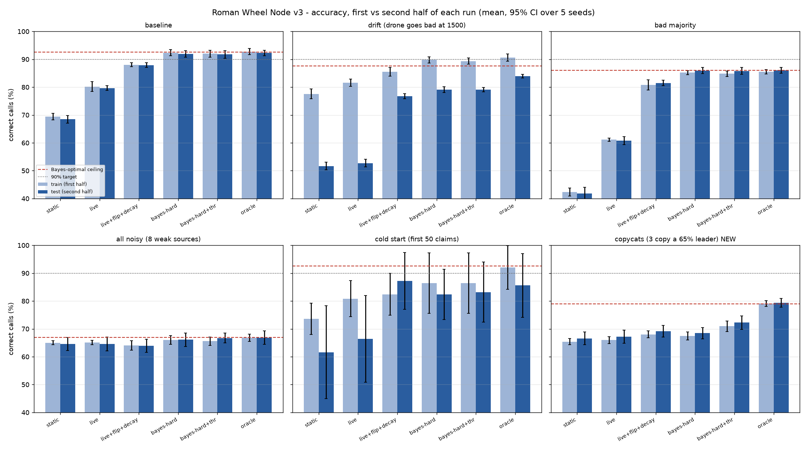

# Roman Wheel Node

[](https://github.com/SynerGro-AI/roman-wheel-node/actions/workflows/ci.yml)
[](LICENSE)

An exact-copy gate plus learned, auditable evidence fusion that decides whether a claim
can enter an agent's trace. Pure Python (3.9+), standard library only, zero dependencies.

**92.1% correct calls on the baseline benchmark, against a 92.5% Bayes-optimal ceiling.**

## Install

Not on PyPI yet. Install from GitHub:

```bash
pip install "git+https://github.com/SynerGro-AI/roman-wheel-node@v1.0.0"
# or, for development
git clone https://github.com/SynerGro-AI/roman-wheel-node && cd roman-wheel-node
pip install -e ".[test,bench]" && python -m pytest -q
```

## Design from first principles

**1. Gate first, then weigh.** Some checks are binary facts (hash match, binary selection,
drawing invariant). Weighing can't make up for a failed fact, so `a = 0` BLOCKs before anything
else. A source score of exactly 0 is a veto: it means "this is impossible", not "weak evidence",
so it BLOCKs no matter how much that source is trusted. No scores means no evidence, so that BLOCKs too.

**2. Why log-odds (`mode="bayes"`).** We want P(claim true | what the sources said). If the sources
are independent, Bayes' rule says the evidence *adds* in log-odds space:

    logit P(true | s1..sn) = logit(prior) + Σ_k log[ P(s_k | true) / P(s_k | false) ]

If source k is right with probability r_k, its vote is worth ±logit(r_k) = ±log(r_k / (1 − r_k)). This gives three
things for free that the geometric mean only handled with patches:
* r > 0.5 counts as positive evidence, r = 0.5 (a coin flip) counts as exactly zero, and r < 0.5 counts as
  *negative* evidence, so a liar is inverted automatically with no `flip` flag.
* More agreeing sources raise confidence. Product mode does the opposite: more evidence lowers the score.
* `eff` is a real probability, so the natural ACCEPT boundary is 0.5 rather than a hand-picked 0.35.

There are three likelihood variants, and all were benchmarked: `hard` (the source's vote: score > 0.5), `soft`
(the score treated as P(source says true)) and `logit` ((2r−1)·logit(score)). **`hard` was the best or tied for best
everywhere, so it is the default.** In this data the score's distance from 0.5 carries little information beyond which
side it falls on. Each source's r is capped to [0.01, 0.99], which limits any one source to ±4.6 log-odds.

**3. Why append-only ledgers.** Every piece of feedback is a new JSONL line. State is a pure function of the ledger,
so it can be audited ("why did you trust drone?"), replayed deterministically, and re-run under different settings.
Nothing is ever overwritten, which means a bug or a bad setting can't destroy past learning.

**4. Why decay (half-life 150 by default).** Sources change. Without forgetting, a source that was right
1,500 times needs hundreds of failures before its trust drops. Decay is applied *while replaying*, so the
ledger itself stays complete and you can replay with `half_life=None` at any time.

**5. Why a learned threshold.** A cut-off is only right if `eff` is calibrated. When the model's assumptions are
broken (for example, correlated sources), the posterior becomes over-confident. `ThresholdLearner` keeps an
append-only ledger of `(eff, truth)` for each mode and picks the cut-off that maximised decayed accuracy over recent
outcomes (half-life 500, 0.001 grid, `default` until `min_obs`).

## Limits (stated honestly)
* **The independence assumption.** Sources that copy each other get counted several times. In the `copycats`
  scenario the node reaches 71.6%, while the optimum is 79%. The learned threshold recovers about 3.6 points of
  that gap. A real fix needs a model of the correlation (see next steps).
* **The information ceiling.** No fusion rule can beat the Bayes-optimal oracle. Eight independent 58%-accurate
  sources cap out at about 67% (exact majority-vote value: 67.1%). Reaching 90% would take about 63 such sources.
* **Feedback is required.** Reliabilities come from right/wrong feedback. With no feedback, the node uses
  `assumed_reliability` (0.75) for bayes mode, or equal trust for geomean.
* **The simulations are only simulations.** The real accuracy of your sources is what sets the ceiling.

## API

```python
from roman_wheel_node import roman_wheel_node, LiveWeights, ThresholdLearner, give_feedback

live = LiveWeights("weights_ledger.jsonl")           # half_life=150 by default (None = never forget)
thr  = ThresholdLearner("threshold_ledger.jsonl")    # half_life=500, min_obs=30, default cut-off 0.5

scores = {"drone": 0.95, "trial": 0.81, "instr": 0.12}
eff, op, status = roman_wheel_node(1, scores, live, mode="bayes", threshold=thr)  # variant="hard"
# ... later, when the truth is known:
give_feedback(scores, truth=True, live=live, threshold=thr, eff=eff, mode="bayes")
```

`roman_wheel_node(a, scores, live=None, mode="geomean", log_path=None, flip=False, threshold=None,
variant="hard", prior=0.5, assumed_reliability=0.75, cutoff=None) -> (eff, opcode, status)`

* `mode`: `"geomean"` (default, v1/v2), `"product"`, or `"bayes"` (new).
* Opcodes without a learner: geomean/product use the fixed v1 bands (≥0.85 `111`, ≥0.65 `110`, ≥0.35 `101`,
  >0.05 `100` HEDGE). Bayes uses cut-off 0.5. `cutoff=<float>` sets a fixed cut-off, and `cutoff="fixed"` forces the v1 bands.
* Opcodes with a learner: ACCEPT iff `eff ≥ c`; the span [c, 1] is split into thirds for `101`/`110`/`111`; HEDGE `100`
  covers `[c − 0.15, c)` but only above 0.05; anything lower is BLOCK.
* Backward compatible: every v2 call gives bit-identical results, and the 6 original tests are unchanged
  (checked by pytest against a frozen v2 reference, `tests/_v2_reference.py`, on 1,600 random claims).
* **Behaviour change:** the `LiveWeights` default `half_life` is now 150. Pass `half_life=None` to get v2 behaviour
  (`benchmarks/train_sim.py` pins this so its old results still reproduce).

## Results (`python benchmarks/run_benchmark.py`, 5 seeds, mean ± 95% CI using t with 4 dof)

Accuracy is the share of right calls (a HEDGE counts as not accepted). TA is the share of true claims accepted.
FB is the share of false claims blocked. The ceiling is the Bayes-optimal oracle, which knows the true accuracies
and the score model; it was measured on 200k claims.

| Scenario (ceiling) | static | live+flip+decay (v2 best) | **bayes-hard** | bayes-hard+thr | oracle (same claims) |
|---|---|---|---|---|---|
| baseline (92.5%) | 68.9 ±1.2 | 88.0 ±0.7 | **92.1 ±1.2** (TA 92.3 / FB 92.0) | 91.9 ±1.3 | 92.5 |
| drift (87.6%) | 64.6 ±0.9 | 81.1 ±1.0 | **84.5 ±0.8** (85.1 / 83.8) | 84.2 ±0.6 | 87.3 |
| bad majority (86.0%) | 42.1 ±1.3 | 81.1 ±1.4 | **85.6 ±0.8** (85.8 / 85.4) | 85.3 ±1.0 | 85.8 |
| 8 weak 58% sources (66.9%) | 64.8 ±1.3 | 64.0 ±1.9 | **66.1 ±1.6** (66.7 / 65.4) | 66.1 ±1.4 | 66.8 |
| cold start, 50 claims (92.5%) | 67.6 ±6.9 | 84.8 ±4.5 | 84.4 ±4.8 (84.0 / 84.4) | 84.8 ±6.5 | 88.8 |
| copycats, NEW (78.9%) | 66.0 ±1.6 | 68.6 ±1.3 | 68.0 ±1.4 (68.3 / 67.7) | **71.6 ±1.7** (74.2 / 68.8) | 79.2 |

The full table (all 10 policies, train/test halves, CIs) is in `benchmarks/results_v1.0.0.txt` / `.json`.
It is reproducible: the benchmark is seeded, and re-running it regenerates the same numbers.



## Layout
* `src/roman_wheel_node/core.py`: the implementation. The public API is re-exported from `roman_wheel_node`.
* `tests/test_roman_wheel.py`: 58 unit tests. They cover the gate, empty scores, the hard-zero veto, clamping,
  append-only ledgers, replay determinism, decay, flip, Bayes posterior sanity, the learned threshold and bit-compatibility with v2.
* `benchmarks/run_benchmark.py`: six scenarios × ten policies × five seeds, plus the Bayes-optimal oracle ceilings.
* `benchmarks/train_sim.py`: the original 3,000-claim training demo.

## Next steps
* Correlation-aware fusion: learn pairwise agreement between sources from the ledger and shrink the weight of
  redundant sources (this is the main remaining gap, in `copycats`).
* Learned score calibration per source: histogram P(truth | score bin) from the ledger, replacing the fixed soft/hard models.
